# Grammatica Architecture & Data Model Specification

This document provides a comprehensive **Entity Relationship Diagram (ERD)** and the formal **Scope and Delimitations** for the **Grammatica** language learning ecosystem.

---

## 1. System Overview & Architecture Paradigm

Grammatica is an intelligent language learning platform built using a cross-platform **Flutter** client (supporting Web, Android, iOS, and Desktop), backed by **Google Firebase** (Firebase Authentication, Cloud Firestore, Firebase Storage), **FastAPI** AI backends, and **Google Gemini** generative intelligence (via the Firebase AI Logic SDK and REST APIs).

### Database Model: Document-Store NoSQL with Hybrid Session Drafting
Because Cloud Firestore is a NoSQL document database, data modeling combines:
1. **Top-level root collections** for globally queried entities (`users`, `lessons`, `quizzes`, `published_content`, `educator_applications`, `mentorship_sessions`, `notifications`, `spelling_words`, `images`, `settings`).
2. **Subcollections** scoped to parent entities to ensure data encapsulation and secure security rules (`progress`, `quizProgress`, `flashcard_progress`, `study_sessions`, `subscribers`, `subscriptions`, `reviews`, `achievements`).
3. **Session-First Local Workspace**: Educator AI notebooks and source ingestion utilize local in-memory and `SharedPreferences` caching for private drafting, synchronizing to Firestore root and subcollections upon publication.

---

## 2. Entity Relationship Diagram (ERD)

```mermaid
erDiagram
    USERS {
        string uid PK "Firebase Auth UID"
        string email
        string username
        string full_name
        string phone_number
        timestamp date_of_birth
        string role "LEARNER | EDUCATOR | VALIDATOR | ADMIN | SUPERADMIN"
        string status "ACTIVE | SUSPENDED | PENDING"
        string subscription_status "NONE | SUBSCRIBED | ACTIVE | CANCELLED"
        string photoUrl
        boolean has_completed_onboarding
        string theme_preference "light | dark"
        string bio
        list specializations
        number totalRating
        number reviewCount
        number averageRating
        number hourlyRate
        boolean isAvailableForMentorship
        map subscription_pricing "standard, premium rates"
        number subscription_fee
        timestamp educatorStartDate
        timestamp educatorEndDate
        timestamp createdAt
    }

    EDUCATOR_APPLICATIONS {
        string id PK "Application UUID"
        string applicantUid FK "users.uid"
        string applicantEmail
        string applicationType "educator | validator"
        string status "pending | approved | rejected"
        string cvUrl
        list certificateUrls
        string videoUrl
        string syllabusUrl
        string rejectionReason
        string rejectionDescription
        timestamp appliedAt
    }

    LESSONS {
        string id PK "Lesson Document ID"
        string title
        string prompt
        string answer
        string createdByUid FK "users.uid"
        string createdByEmail
        string attachmentUrl
        string attachmentName
        string imageUrl
        string quizId FK "quizzes.id"
        string notebookId FK "notebooks.id"
        string validationStatus "approved | awaiting_approval | rejected"
        string rejectionReason
        boolean isVisible
        list visibleTo "Role or subscriber UIDs"
        boolean isMembersOnly
        boolean isGrammaticaLesson
        timestamp createdAt
    }

    QUIZZES {
        string id PK "Quiz Document ID"
        string title
        string description
        list questions "Array of QuizQuestion objects"
        number duration "Time limit in minutes"
        number maxAttempts
        string createdByUid FK "users.uid"
        string createdByEmail
        string attachmentUrl
        string attachmentName
        string validationStatus "approved | awaiting_approval | rejected"
        string rejectionReason
        boolean isVisible
        list visibleTo
        boolean isMembersOnly
        boolean isGrammaticaQuiz
        boolean isAssessment
        string notebookId FK "notebooks.id"
        timestamp createdAt
    }

    PUBLISHED_CONTENT {
        string id PK "Content Document ID"
        string type "flashcards | study_guide | timeline | briefing | faq | mind_map"
        string title
        map data "Structured payload per content type"
        string createdByUid FK "users.uid"
        string createdByEmail
        timestamp createdAt
        boolean isVisible
        list visibleTo
        boolean isMembersOnly
        boolean isGrammaticaContent
        string validationStatus "approved | awaiting_approval | rejected"
        string notebookId FK "notebooks.id"
        string outputId "Local draft session output ID"
    }

    NOTEBOOKS {
        string id PK "Notebook UUID"
        string title
        string description
        string createdBy FK "users.uid"
        timestamp createdAt
        timestamp updatedAt
        list sourceIds
        list outputIds
        string coverImageUrl
        list tags
    }

    NOTEBOOK_SOURCES {
        string id PK "Source UUID"
        string notebookId FK "notebooks.id"
        string type "pdf | text | url | audio | video"
        string title
        string rawContent "Extracted or provided text"
        string originalUrl
        string storageUrl
        map metadata "byteLength, wordCount, filename"
        string processingStatus "pending | processing | ready | error"
        string errorMessage
        timestamp createdAt
    }

    NOTEBOOK_OUTPUTS {
        string id PK "Output UUID"
        string notebookId FK "notebooks.id"
        string type "lesson | flashcards | quiz | study_guide | timeline | briefing | faq | mind_map"
        string title
        map data "Structured JSON response"
        timestamp generatedAt
        list sourceIds
        boolean isShared
        timestamp sharedAt
        list sharedTo "User UIDs or all_subscribers"
        string publishedId FK "lessons.id | quizzes.id | published_content.id"
        string publishedCollection "lessons | quizzes | published_content"
        map publishMetadata
    }

    USER_PROGRESS {
        string lessonId PK "lessons.id"
        string uid FK "users.uid"
        boolean completed
        timestamp completedAt
    }

    USER_QUIZ_PROGRESS {
        string quizId PK "quizzes.id"
        string uid FK "users.uid"
        boolean completed
        boolean passed
        number score
        number totalQuestions
        number attemptsUsed
        number timeTaken "Seconds elapsed"
        map lastAnswers
        timestamp lastAttemptAt
    }

    FLASHCARD_PROGRESS {
        string progressId PK "deckId_cardId"
        string cardId
        string deckId
        string uid FK "users.uid"
        number easeFactor "SM-2 multiplier (default 2.5)"
        number interval "Days until next review"
        number repetitions "Consecutive recall streaks"
        timestamp nextReviewDate
        timestamp lastReviewDate
        number quality "Recall quality (0 to 5)"
    }

    STUDY_SESSIONS {
        string id PK "Session UUID"
        string deckId
        string userId FK "users.uid"
        timestamp startedAt
        timestamp endedAt
        number cardsStudied
        number cardsCorrect
        number averageQuality
    }

    SUBSCRIBERS {
        string subscriberId PK "users.uid of Learner"
        string educatorUid FK "users.uid of Educator"
        timestamp subscribedAt
        string tier "basic | standard | premium"
    }

    SUBSCRIPTIONS {
        string educatorUid PK "users.uid of Educator"
        string learnerUid FK "users.uid of Learner"
        string status "active | cancelled"
        string tier "basic | standard | premium"
        string billingCycle "monthly"
        timestamp subscribedAt
        timestamp cancelledAt
    }

    REVIEWS {
        string id PK "Review UUID"
        string educatorUid FK "users.uid"
        string reviewerUid FK "users.uid"
        string reviewerName
        number rating "1.0 to 5.0"
        string comment
        timestamp createdAt
    }

    MENTORSHIP_SESSIONS {
        string id PK "Session UUID"
        string educatorId FK "users.uid"
        string studentId FK "users.uid"
        string studentName
        string meetingTitle
        string conferenceApp "google_meet | zoom | teams"
        string meetingLink
        timestamp startTime
        timestamp endTime
        string status "scheduled | completed | cancelled"
        timestamp createdAt
        timestamp completedAt
        timestamp updatedAt
    }

    NOTIFICATIONS {
        string id PK "Notification UUID"
        string uid FK "users.uid"
        string title
        string message
        string type "welcome | appRejected | appApproved | achievement | profileReminder | subscription | general"
        boolean isRead
        boolean isArchived
        string rejectionReason
        string rejectionDescription
        timestamp createdAt
    }

    SPELLING_WORDS {
        string id PK "Word UUID"
        string word
        string word_lowercase
        string difficulty "NOVICE | AMATEUR | PROFESSIONAL"
        string audioUrl
        string createdByUid FK "users.uid"
        timestamp createdAt
    }

    IMAGES {
        string id PK "Image UUID"
        string userId FK "users.uid"
        string imageUrl
        string fileName
        string description
        timestamp uploadedAt
    }

    USER_ACHIEVEMENTS {
        string achievementId PK "Achievement Key Identifier"
        string uid FK "users.uid"
        timestamp unlockedAt
    }

    SETTINGS {
        string id PK "landing_page"
        list hero_images
    }

    %% Relationships
    USERS ||--o{ EDUCATOR_APPLICATIONS : "submits"
    USERS ||--o{ LESSONS : "authors"
    USERS ||--o{ QUIZZES : "authors"
    USERS ||--o{ PUBLISHED_CONTENT : "publishes"
    USERS ||--o{ NOTEBOOKS : "owns"
    USERS ||--o{ USER_PROGRESS : "completes"
    USERS ||--o{ USER_QUIZ_PROGRESS : "attempts"
    USERS ||--o{ FLASHCARD_PROGRESS : "reviews_via_sm2"
    USERS ||--o{ STUDY_SESSIONS : "logs_sessions"
    USERS ||--o{ SUBSCRIBERS : "educator_has"
    USERS ||--o{ SUBSCRIPTIONS : "learner_maintains"
    USERS ||--o{ REVIEWS : "receives_reviews"
    USERS ||--o{ MENTORSHIP_SESSIONS : "hosts_or_attends"
    USERS ||--o{ NOTIFICATIONS : "receives"
    USERS ||--o{ IMAGES : "uploads"
    USERS ||--o{ SPELLING_WORDS : "registers"
    USERS ||--o{ USER_ACHIEVEMENTS : "unlocks"

    NOTEBOOKS ||--o{ NOTEBOOK_SOURCES : "ingests"
    NOTEBOOKS ||--o{ NOTEBOOK_OUTPUTS : "generates"
    NOTEBOOKS ||--o{ LESSONS : "curates_into"
    NOTEBOOKS ||--o{ QUIZZES : "curates_into"
    NOTEBOOKS ||--o{ PUBLISHED_CONTENT : "bundles_into"

    LESSONS ||--o| QUIZZES : "attaches_assessment"
    LESSONS ||--o{ USER_PROGRESS : "tracked_in"
    QUIZZES ||--o{ USER_QUIZ_PROGRESS : "evaluated_in"
```

---

## 3. Entity Dictionary & Collection Structure

| Collection / Subcollection Path | Entity Name | Primary Key | Key Foreign Keys | Purpose & Behavior |
| :--- | :--- | :--- | :--- | :--- |
| `/users/{uid}` | **User** | `uid` | None (Auth UID) | Stores user profiles, RBAC roles (`LEARNER`, `EDUCATOR`, `VALIDATOR`, `ADMIN`, `SUPERADMIN`), ratings, bios, and subscription fees. |
| `/users/{uid}/progress/{lessonId}` | **UserProgress** | `lessonId` | `uid`, `lessonId` | Records learner lesson completion status and timestamps. |
| `/users/{uid}/quizProgress/{quizId}` | **UserQuizProgress** | `quizId` | `uid`, `quizId` | Records quiz attempt counts, scores, pass/fail status, answer payloads, and duration. |
| `/users/{uid}/flashcard_progress/{id}` | **FlashcardProgress** | `deckId_cardId` | `uid` | Implements SuperMemo 2 (SM-2) spaced repetition intervals, ease factors, and next review dates. |
| `/users/{uid}/study_sessions/{id}` | **StudySession** | `id` | `uid`, `deckId` | Historical audit logs of completed flashcard review sessions with quality metrics. |
| `/users/{educatorUid}/subscribers/{uid}`| **Subscriber** | `learnerUid` | `educatorUid`, `learnerUid`| Tracks active subscribers from the educator's perspective for audience restriction and revenue tracking. |
| `/users/{learnerUid}/subscriptions/{uid}`| **Subscription**| `educatorUid` | `learnerUid`, `educatorUid`| Tracks an individual learner's active/cancelled educator subscriptions and billing tiers. |
| `/users/{educatorUid}/reviews/{id}` | **Review** | `id` | `educatorUid`, `reviewerUid`| Learner feedback, ratings (1-5 stars), and written comments on educators. |
| `/users/{uid}/achievements/{id}` | **UserAchievement** | `achievementId` | `uid` | Milestones and badges unlocked by users (e.g. `profile_reminder`, first completed module). |
| `/educator_applications/{id}` | **EducatorApplication** | `id` | `applicantUid` | Verification dossiers (CV, certifications, video, syllabus) submitted by educators or validators for admin review. |
| `/lessons/{id}` | **Lesson** | `id` | `createdByUid`, `quizId`, `notebookId` | Core curriculum lessons containing rich markdown prompts, explanations, attachments, and validation status. |
| `/quizzes/{id}` | **Quiz** | `id` | `createdByUid`, `notebookId` | Evaluative quizzes consisting of heterogeneous questions (multiple choice, passage, short answer, fill-in-the-blank). |
| `/published_content/{id}` | **PublishedContentItem**| `id` | `createdByUid`, `notebookId` | Published companion artifacts: flashcard decks, mind maps, study guides, chronologies, briefing documents, and FAQs. |
| `/notebooks/{id}` | **Notebook** | `id` | `createdBy` | Research workspaces grouping ingested sources and drafted AI learning outputs. |
| `/notebooks/{id}/sources/{id}` | **NotebookSource** | `id` | `notebookId` | Ingested source files (PDFs, URLs, raw text, audio/video) and their extracted text representations. |
| `/notebooks/{id}/outputs/{id}` | **NotebookOutput** | `id` | `notebookId`, `publishedId` | AI-generated artifacts drafted within a notebook prior to curriculum publication. |
| `/mentorship_sessions/{id}` | **MentorshipSession** | `id` | `educatorId`, `studentId` | Synchronous one-on-one video mentorship appointments integrated with Google Meet, Zoom, or Teams. |
| `/notifications/{id}` | **NotificationModel** | `id` | `uid` | User-targeted notifications for approvals, rejections, system reminders, and subscription changes. |
| `/spelling_words/{id}` | **SpellingWord** | `id` | `createdByUid` | Curated vocabulary items with difficulty classifications and audio URLs for the interactive Spelling Bee. |
| `/images/{id}` | **ImageUpload** | `id` | `userId` | Uploaded image assets hosted on Firebase Storage and linked to lessons or questions. |
| `/payments/{paymentId}` | **PaymentLedger** | `paymentId` | `learnerUid`, `educatorUid` | Platform-wide immutable ledger of confirmed subscription payments with deterministic keys (`pay_{ref}`) preventing duplicate billing. |
| `/users/{uid}/payments/{id}` | **UserPayment** | `paymentId` | `learnerUid`, `educatorUid` | Learner-scoped payment receipts and transaction records for active subscription tier access. |
| `/idempotency_keys/{key}` | **IdempotencyKey** | `key` | None | Distributed idempotency locks and state records preventing concurrent or duplicated operations across Flutter, Firebase, and FastAPI. |
| `/settings/landing_page` | **Settings** | `landing_page` | None | Administrative global configurations (e.g., dynamic hero showcase carousel images). |

---

## 4. Scope and Delimitations

### 4.1. Scope of the System
The scope identifies the specific features, user roles, technical capabilities, and workflows officially designed, built, and supported by the Grammatica platform.

#### 1. Target Audience & Role-Based Access Control (RBAC)
- **Learners**:
  - Sign in via Email/Password (with 6-digit OTP verification) or Google Single Sign-On (GIS).
  - Browse verified educators, view public lessons, and enroll in tiered subscription plans (`Basic`, `Standard`, `Premium`).
  - Study interactive lessons, submit quizzes with immediate feedback and attempt throttling, practice flashcards with SM-2 spaced repetition, participate in the Spelling Bee, and practice speech with pronunciation evaluation.
  - Book, reschedule, and participate in one-on-one video mentorship sessions with educators.
  - Rate and review educators; earn milestone achievements.
- **Educators**:
  - Apply for verified educator accreditation by submitting credentials, CVs, introductory videos, and syllabi.
  - Utilize AI-powered Research Notebooks to ingest multi-modal source documents (PDFs, raw notes, web URLs, audio, video).
  - Generate multi-format educational materials using Google Gemini (Lessons, Quizzes, Flashcard Decks, Study Guides, Timelines, Briefing Documents, FAQs, Mind Maps).
  - Set custom subscription pricing, view subscriber analytics, and manage active subscriber rosters.
  - Schedule and manage live 1-on-1 mentorship appointments with automated conference badge linking (Google Meet, Zoom, MS Teams).
- **Validators**:
  - Dedicated pedagogical quality-assurance portal to review curriculum contributions.
  - Approve or reject submitted lessons, quizzes, and published study aids with actionable feedback and structured rejection reasons.
- **Admins & Superadmins**:
  - Manage user accounts, role escalations, account suspensions, and educator application approvals.
  - Oversee platform-wide curriculum items, assessments, and spelling bee lexicons.
  - Configure dynamic landing page branding and broadcast notifications.

#### 2. AI Generation & Educational Processing Pipeline
- **Hybrid AI Engine**: Triple-mode AI architecture supporting (1) Firebase AI Logic SDK, (2) Direct client-side Gemini REST API invocation with in-engine PDF extraction, and (3) Python FastAPI backend (`ai_backend`).
- **Structured Content Blocks**: Generates lessons and quiz questions rendered with text paragraphs, tables, bulleted lists, and visual image aids.
- **Cognitive Study Tools**: Automated distillation of study guides (key terms, summaries, takeaways), chronological timelines, briefing summaries with prioritized action items, FAQs, and interactive node-edge Mind Maps.

#### 3. Monetization & Payment Infrastructure
- Integrated with the **PayMongo API** to handle regional Philippine e-wallet transactions (GCash, Maya, QR Ph) and credit/debit card checkouts via dynamic payment links and QR generation.

#### 4. Distributed Idempotency System Architecture
To completely prevent duplicate payments, double subscriber activations, duplicate email receipts, and redundant AI model executions, Grammatica enforces a distributed 3-tier idempotency system:
1. **Client-Side Coalescing (Single-Flight)**: The Flutter `IdempotencyService` intercepts concurrent user interactions (e.g. repeated button clicks or network retries) and merges in-flight operations to a single asynchronous execution.
2. **Backend API Middleware (IETF / Stripe Specification)**: The FastAPI `IdempotencyMiddleware` evaluates incoming `Idempotency-Key` headers on state-mutating requests (`/payment/create-link`, `/payment/webhook`, `/email/send`, AI generation). It verifies payload fingerprints via SHA-256, blocks concurrent duplicates with HTTP 409 Conflict, and replays cached successful responses (`Idempotent-Replay: true`).
3. **Database Ledger Level Idempotency**: Cloud Firestore records use deterministic document keys (`pay_{ref}`) and transactional verification. If a payment record exists in `status: paid`, subsequent webhook or client notifications cleanly replay without re-incrementing subscriptions, re-running notifications, or sending duplicate receipts.

#### 5. Cross-Platform Client Architecture
- Built with Flutter for responsive presentation across Mobile (Android, iOS), Web, and Desktop environments, incorporating dark and light theme modes.

---

### 4.2. Delimitations of the System
The delimitations specify the intentional boundaries, technical trade-offs, and environmental constraints consciously excluded from the project implementation.

1. **Database & Storage Architecture (NoSQL vs Relational)**:
   - *Delimitation*: Grammatica does not use a traditional relational database (such as PostgreSQL or MySQL). Entity relationships are maintained through document references, denormalized snapshots, subcollections, and batched writes in Cloud Firestore.
   - *Rationale*: Firestore provides high real-time scalability, reactive UI stream binding, offline cache resilience, and seamless security rule integration across mobile and web clients.

2. **Network Connectivity Requirements**:
   - *Delimitation*: Although local drafting of notebooks (`SharedPreferences`) and offline SM-2 flashcard review caching are supported, Grammatica is not fully offline-first. AI generation, real-time Firestore synchronization, payment link generation, and media streaming require an active internet connection.

3. **Live Video Conferencing Infrastructure**:
   - *Delimitation*: The application does not host an internal WebRTC/SIP video streaming server or in-app calling media stream.
   - *Rationale*: To ensure high video call reliability and reduce infrastructure costs, mentorship sessions leverage secure deep-linking and integration with established external providers (Google Meet, Zoom, Microsoft Teams).

4. **Payment Gateway Geographical Coverage**:
   - *Delimitation*: Payment processing is delimited to the PayMongo gateway, primarily targeting Southeast Asian e-wallets (GCash, Maya) and regional card schemes. International gateways such as Stripe, PayPal, or platform-native mobile In-App Purchases (Google Play Billing / Apple App Store StoreKit) are not implemented.

5. **Speech Recognition and Acoustic Modeling**:
   - *Delimitation*: Pronunciation analysis and speech-to-text functionality utilize the offline Vosk speech plugin and Web Speech APIs. The acoustic model is delimited to the English language and does not include custom phoneme-level IPA acoustic modeling for regional non-standard dialects.

6. **Local LLM Model Hosting**:
   - *Delimitation*: No large language models (LLMs) are packaged or executed locally on user devices. All AI generation is delimited to cloud API inference with Google Gemini models to prevent prohibitive mobile hardware overhead and memory exhaustion.

7. **Multi-Tenant Institutional Administration**:
   - *Delimitation*: The system does not support hierarchical institutional tenants (e.g. distinct university or school district organizational partitions, LMS LTI 1.3 standards, or SCORM compliance). Grammatica is designed as an open, direct educator-to-learner marketplace.
